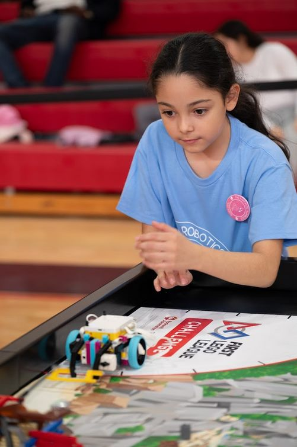
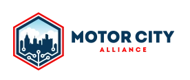
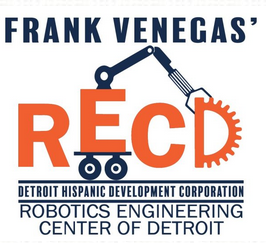
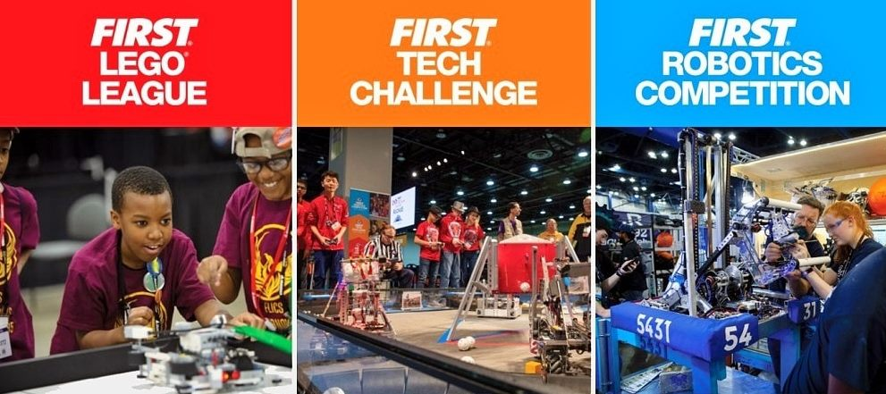

# FLL & FTC in Detroit

## Team Development And Program Building

MEZ Teacher/Coach Workshop

[tinyurl.com/progbuilding](https://tinyurl.com/progbuilding)

## Remember…

- What we talk about are just things to be aware of
- You do not have to commit to anything you hear about today
- Successful programs are built with passion, not burnout
- Some ideas can help you right away, and maybe others are for later on, or maybe not for you at all, and that’s fine

## FIRST Lego League And FIRST Tech Challenge

MEZ Teacher/Coach Workshop

## FIRST Programs

- FIRST has programs for all ages of youth
- FRC - FIRST Robotics Competition: mostly high school
- FTC - FIRST Tech Challenge: middle school in MI, middle and high school elsewhere
- FLL: FIRST Lego League, mostly elementary in the USA, all youth ages internationally
- Split into K-3 and 4-5 programs in Michigan
- There’s also a pre-K version that’s sunsetting
- FLL is actually much larger than FRC

## FLL and FTC in Detroit

- Season is September-December for most teams
- Detroit has dozens of teams at all levels
- Various groups and individuals support the teams, such as the Motor City Alliance, DHDC, Team 503 Frog Force, UDM, and of course the MEZ
- Teams meet at their schools and on Saturdays
- Events in November/December and in May

## Program Bridges

- Successful, sustainable programs use FLL and FTC as feeder programs
- Detroit has some unique challenges
- The way schools feed into each other
- Transportation…always transportation
- An ideal setup is having high school students mentoring the middle and elementary programs, but we are not there yet

## Checking it out

- You are not expected to coach FLL or FTC on top of FRC.
- If you want to just check things out, you could
- Stop in to a Saturday session and see it
- Stop in to a competition as a spectator
- Volunteer at an event for a day
- Judging is an interesting experience
- Doing Unified Robotics in the fall has some similarities
- Get in touch with coaches of your feeder middle schools and schedule a robot demo to recruit for FRC

## Unified Robotics

- Special Olympics-affiliated robotics program
- Organized by King HS and run at the MEZ and DHDC
- Unified uses the same kits as Lego League
- If your students enjoyed doing Unified, they might enjoy working with elementary students to teach FLL
- Again, not something you’re expected to coordinate

