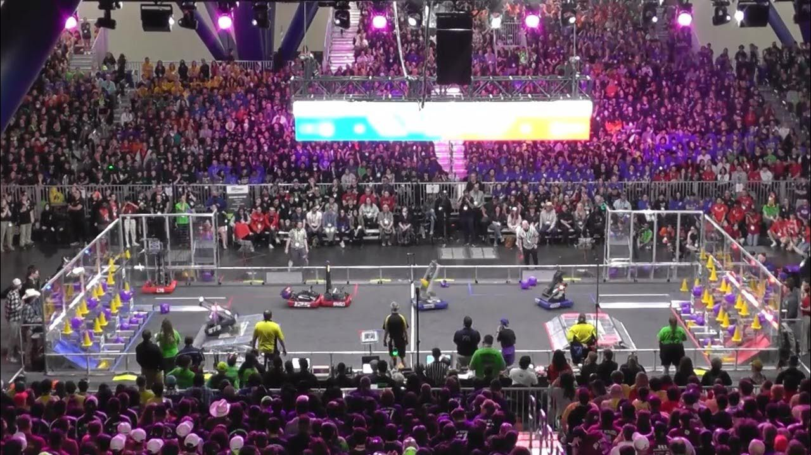

# FRC Deep Dive Part 1 - Events

## FRC Deep Dive Part 1 Events

MEZ Teacher/Coach Workshop

[tinyurl.com/frcdd1](https://tinyurl.com/frcdd1)

## FRC is a lot…

- That can be both bad and good, but mostly it is just a lot
- There are some lesser known aspects to FRC that are good to understand to have a smoother season

## Events

- There are different kinds of events
- District (standard)
- District (third play)
- Regional
- State Championship
- World Championship
- Offseason
- Generally, district, state championship, and offseason events are most relevant to MEZ teams, but there are exceptions

## District Events

- Every team gets two district events by default; these are your standard events
- You play 12 matches and potentially playoffs
- You earn district points towards qualifying for the state championship based on your final rank, how many playoff matches you win, and any awards you earn
- There is a lottery for third district events; if you win you can sign up for $500
- Third plays do not count towards state rankings. Your first two events count towards qualification, even if one of them is the one you got into from the lottery.

## Regionals

- Many teams do not use the district system and instead play at one or more regionals
- These are higher production value but also twice as expensive as district events (you have to register for each individually)
- You could sign up for a regional if you wanted to, but generally these are not relevant for Michigan teams

## State Championship

- The top 160 teams based on district points qualify for the state championship
- There are typically extremely few declines (zero in 2026)
- The event is held in Saginaw in April, and is 4x40 team events in the same arena
- The winners of each sub-event (called divisions) play each other for the overall champion
- Qualifying for the state championship is very hard, but it is doable

## World Championship

- The top ~85 teams from Michigan qualify for the world championship
- Takes place in Houston, TX in late April or early May
- Two MEZ teams qualified last year for the first time ever
- Logistically, extremely difficult to make this work, but it is possible
- There are differing opinions on whether or not this is a good use of resources
- There were 20+ declines from Michigan in 2026

## Offseason Events

- Many events take place on weekends from June-October
- Some are competitive, some are casual, some are a mix of both
- Good opportunity to get additional drive or pit practice, make friends, and just have fun
- They typically cost $250-400 per event day
- The Detroit City Championship is on Saturday, October 10th this year and is FREE for MEZ teams

## Event Registration

- Event registration is handled through two rounds of “preferencing”, and then an open registration period
- During the preferencing periods, you can make an ordered list of your preferences
- Each team is randomly assigned a number and then the preferences are run in order. Subsequent rounds flip the order.
- If you’re unlucky on the first round, you’re more likely to be lucky on the second, but often only the first round matters
- There are also “home events”

## Home Events

- Every team gets one home event, which is assigned based on your zip code
- During the first round of preferencing, you can either opt in or opt out of your home event
- If you opt in, you are GUARANTEED a spot there
- If you opt out, you may be able to get in later through normal selection, but it’s not guaranteed

## Registration Strategy

- Generally, Detroit events are vastly over capacity
- The Renaissance (later Troy 2) event had almost 40 teams on the waitlist last year
- Gail tries to help us how she can but FIM has to respect the lottery order
- It’s highly recommended to opt in to your home event if it’s in Detroit
- For your second event, you will generally want to list the other Detroit event as your first and only preference, and select “allow waitlist”
- If it turns out you’re way down the waitlist (FIM will tell us), then you can choose a different event
- Your event selections are up to you, and if you want to go to a different event, you can!

## Switching Events

- There’s an “Event Change Request Form” on the FIM website during the season
- Fill it out if you don’t get the event you want
- If you end up 30th on the waitlist it won’t work out, but it doesn’t cost you anything to do
- You can fill out the form for multiple potential event swaps
- The MEZ will try to support the events we can, but if you end up very far away it may not be possible
- We will always support the Detroit events

## Volunteering

- Every team is supposed to volunteer 4 full human days at each district event they attend
- Historically, community-wide, we don’t quite hit that mark
- Many teams fill these roles with parents; that’s not an option for everyone
- There are other great sources of volunteers
- Colleagues from your school
- Responsible students (if your team is large enough)
- Alumni who live in the area
- Alumni are fantastic as they can stay involved without the commitment of mentoring
- We can work together to bring more volunteers into the community
