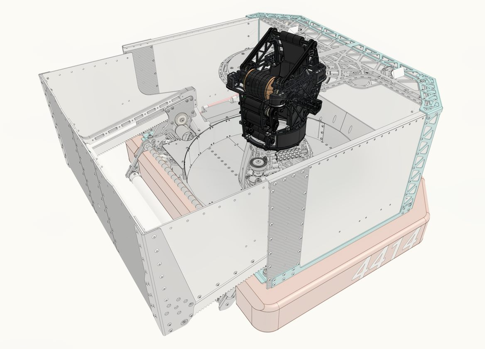
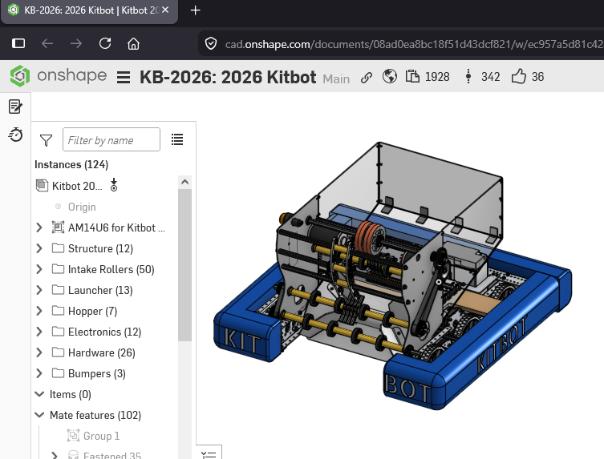
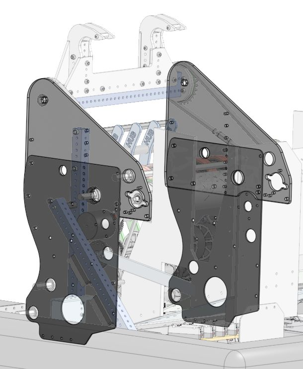
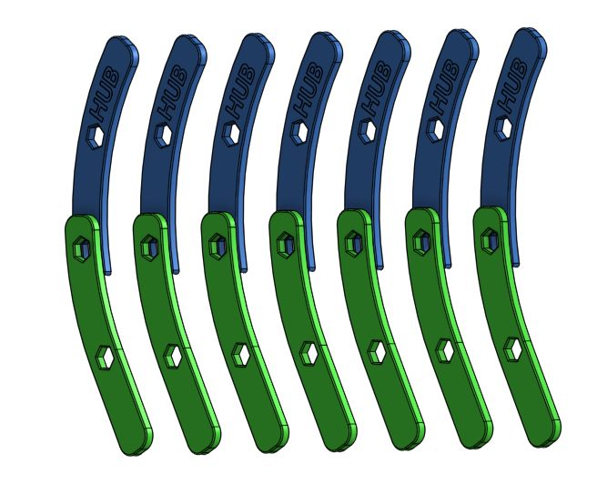
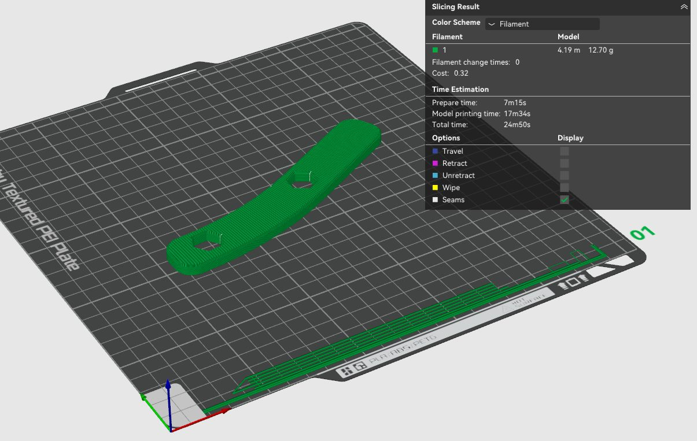

# Intro to CAD, Onshape, and 3DP

## Intro to CAD, Onshape, and 3D Printing

MEZ Teacher/Coach Workshop

## CAD

- “Computer Aided Design”
- How pretty much everything in the world is designed, including robots
- Useful tool even if you aren’t a designer
- In FRC, by far the most common CAD program is Onshape

## Onshape

- Perfect for FRC
- Works online; students don’t need powerful computers
- Most robots you would want to build are published publicly in Onshape
- Mouse highly recommended

## Follow Along

- Everybot 2026 CAD
- [tinyurl.com/ebcad26](https://tinyurl.com/ebcad26)

## Onshape Tools

- Zoom, Pan, Rotate
- Measure
- Hide/Isolate/Section view
- Change configurations
- Find in instance list
- Export

## 3D Printing

- More and more parts can simply be printed
- Easier and more precise than fabricating by hand
- Slow in real time, but fast in terms of human time. Print overnight for best results.
- Good for inspiring students
- The MEZ has printers you can use

## 3D Printing

- Export an STL from Onshape or download it from a vendor
- Open it in what’s called “slicing” software
- Arrange it, duplicate it, etc, and then slice it
- Load the file onto the USB or SD card, and run your print!

## Build Season

- CAD and 3D printing are extremely useful tools for your build season
- Being able to navigate Onshape documents will save you a lot of time when assembling your robot
- Many parts need to be 3D printed, even for Kitbot/Everybot builds
- Use Onshape to export and print parts, or find or design your own upgrades!

## Quick Links

- Rev MAXSwerve Instructions
- [tinyurl.com/revswerve](https://tinyurl.com/revswerve)
- Rev MAXSwerve CAD
- [tinyurl.com/revswervecad](https://tinyurl.com/revswervecad)
- AndyMark Kit Chassis Instructions
- [tinyurl.com/kitchassis](https://tinyurl.com/kitchassis)
- WCP Swerve Instructions
- [tinyurl.com/wcpswerve](https://tinyurl.com/wcpswerve)
- WCP Swerve CAD
- [tinyurl.com/wcpswervecad](https://tinyurl.com/wcpswervecad)
- (Change Style to “Swerve X2i and Mount to “Tube”)
