# Intro to Robot Components

## Intro to Robot Components

MEZ Teacher/Coach Workshop

[tinyurl.com/intro2rc](https://tinyurl.com/intro2rc)

## Common Vendors

- [AndyMark](https://andymark.com/) - the original; solid, entry-level parts
- [Rev Robotics](https://www.revrobotics.com/) - advanced parts but reliability issues in recent years
- [West Coast Products](https://wcproducts.com/) - typically the “best” or most competitive parts, but very expensive
- [Cross the Road Electronics](https://store.ctr-electronics.com/) - MI-based, sells electrical components; partnered with WCP
- [ThriftyBot](https://www.thethriftybot.com/) - growing quickly; sometimes has good parts at lower prices

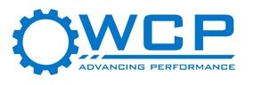
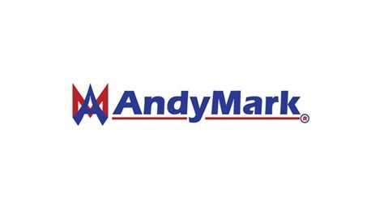
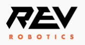

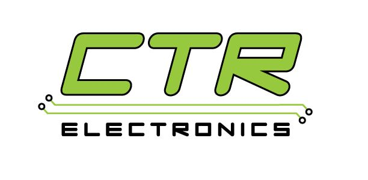

## Battery

- Makes sure crimps are extremely tight
- Otherwise, brownout and fire risk
- Never lift by the cables
- Everyone will do this by default so make a point of warning people
- One of the easiest ways to simply purchase a competitive advantage

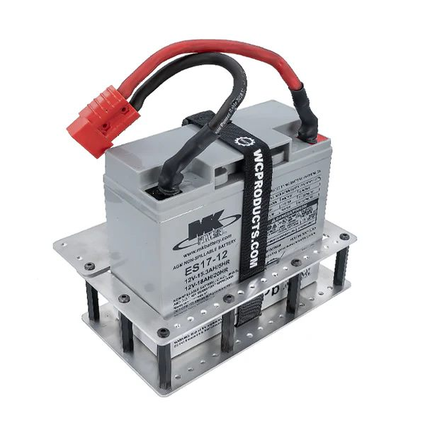

## Main Breaker

- Robot’s on/off switch
- Make sure terminals are extremely tight
- Otherwise, brownout and fire risk
- Make it visible and accessible to field staff

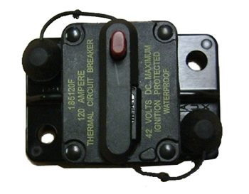

## RoboRio

- The robot’s computer
- Being replaced this upcoming season

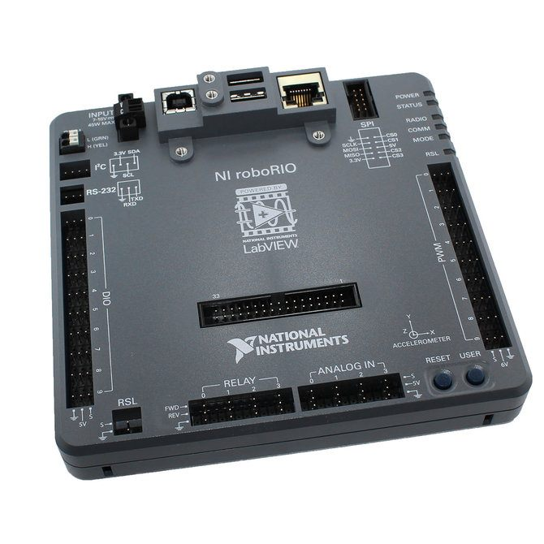

## SystemCore

- Replacing the RoboRio starting this upcoming season
- You can learn a bit more if you want to, or you can wait

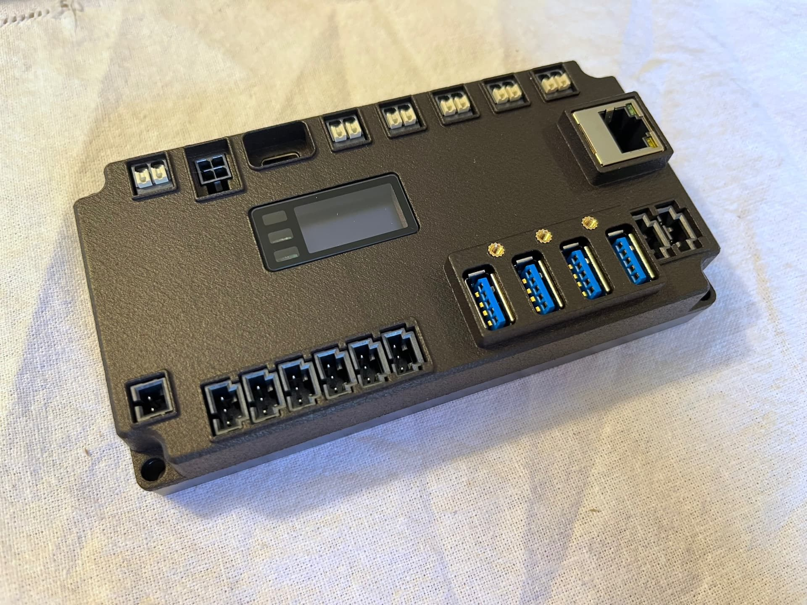

## Power Distribution Board

- Sits between your battery and everything else
- Has snap-action breakers that break, and then reset, if there’s too much current
- Three main variants
- PDP, or power distribution panel
- PDP 2
- PDH, or power distribution hub

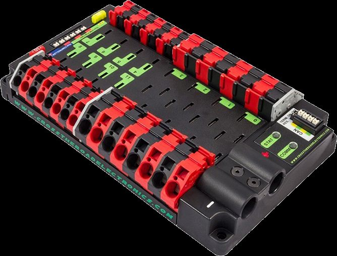
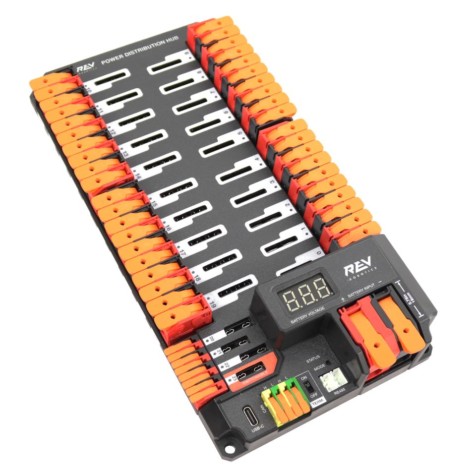
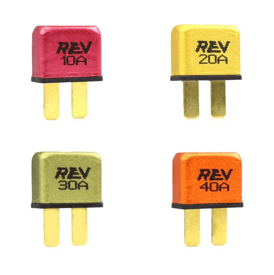

## Motors

- Two types of motor
- Brushed: old, less efficient but fine, cheap
- Brushless: better in every way but expensive
- Two main sizes of motor
- CIM-class: big motors
- Smaller motors (no generic class name)
- Three main brands of motors
- CIMs - brushed but good enough, and free
- Rev NEOs - “normal”, vortex, and mini (550)
- WCP Kraken - normal and mini

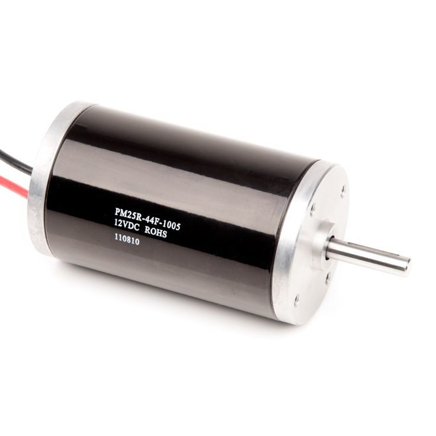
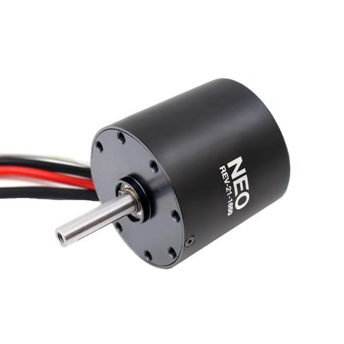
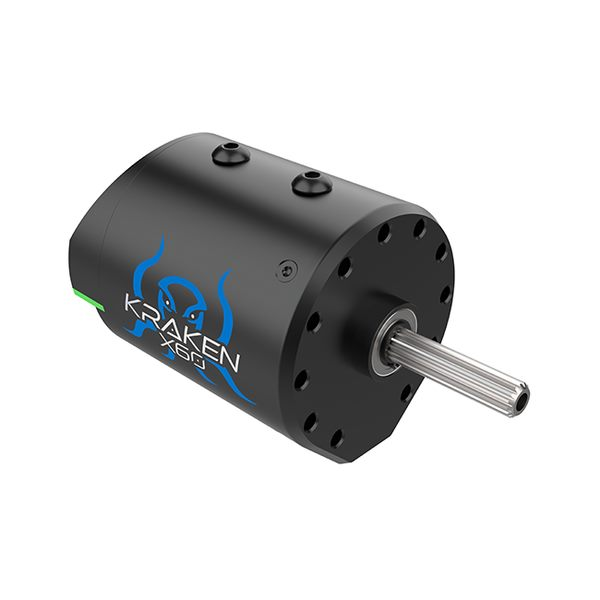

## Motor Controllers

- SparkMax
- By far the most common at the MEZ
- Exists separately from the motor
- Spark Flex
- SparkMax but for the Neo Vortex
- Separate part but docks with the motor
- TalonFX
- For Krakens
- Built in so you don’t think much about it

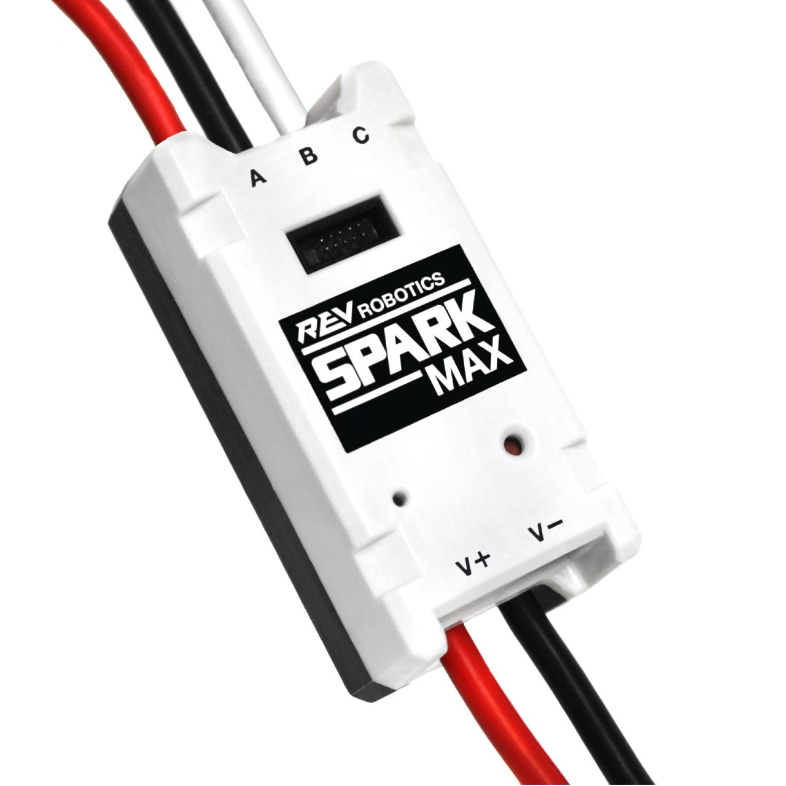
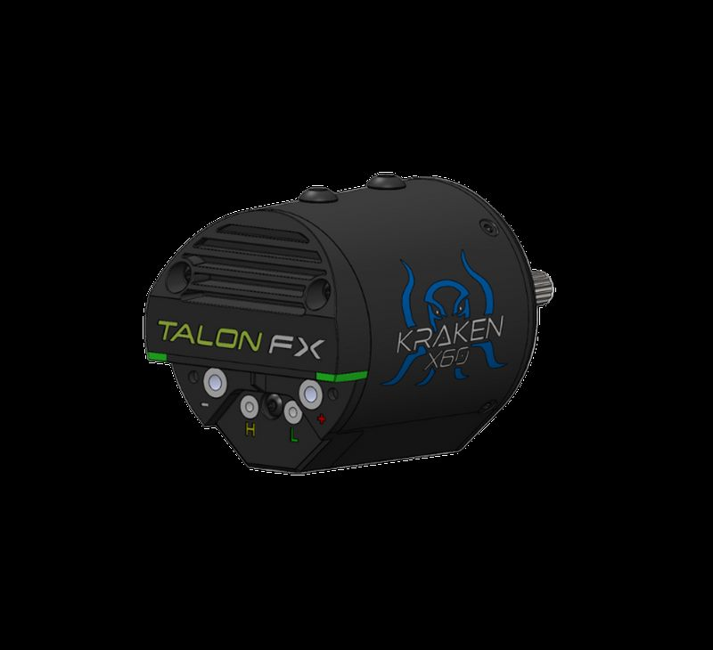
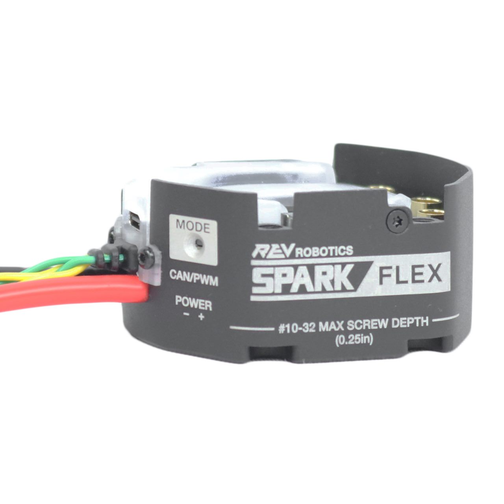

## Motors - Performance

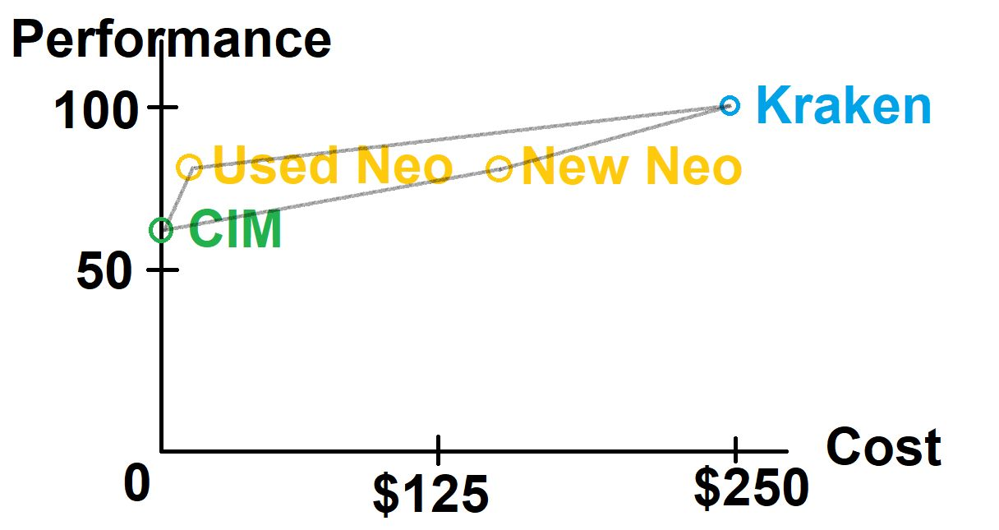

## Gyroscopes

- Also called IMUs, which stands for Inertial Measurement Unit
- Measures rotation of the robot
- Critical for swerve drive
- Helpful for programming
- Several common models
- May be built into SystemCore

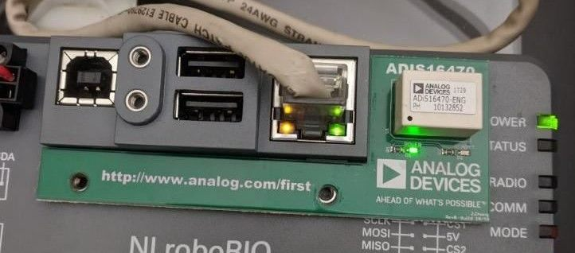
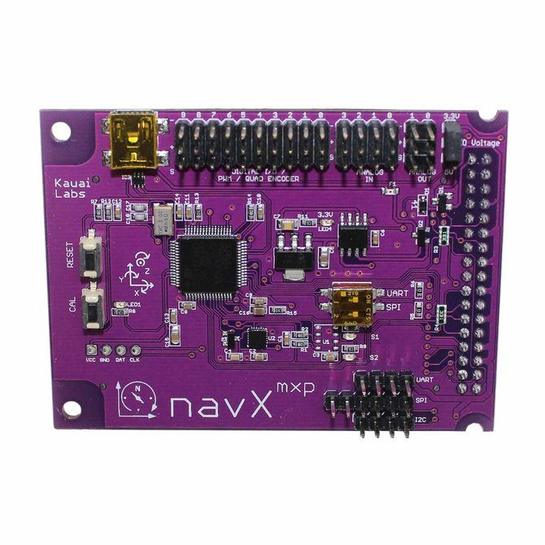
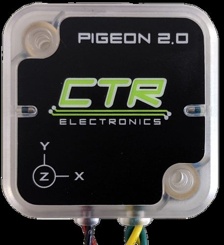

## Encoders

- Measure rotation of a motor or mechanism
- Built in to modern motors, so they’re easy to use
- Two main types: relative and absolute
- Relative Encoders
- Know how many times they’ve spun around
- Great for things like flywheels that repeat positions
- Absolute Encoders
- Know exactly where they are
- Great for things where only the position matters
- Swerve steering
- The position of an arm

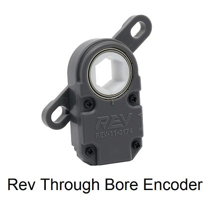
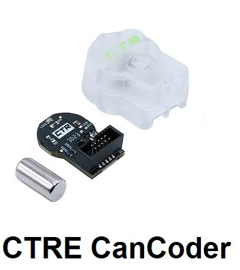

## Additional Power Items

- Sometimes you want extra power slots for small items
- CTRE VRM
- REV Mini-PDH

## Additional Power Items

- Sometimes you want extra power slots for small items
- CTRE VRM
- REV Mini-PDH

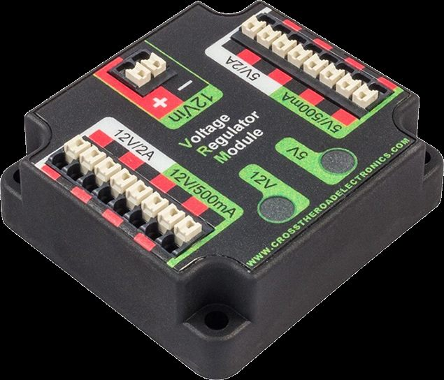
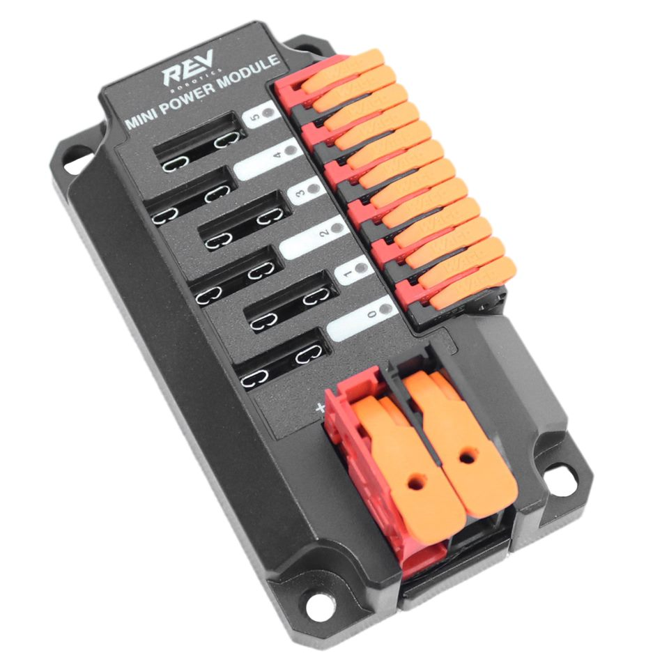

