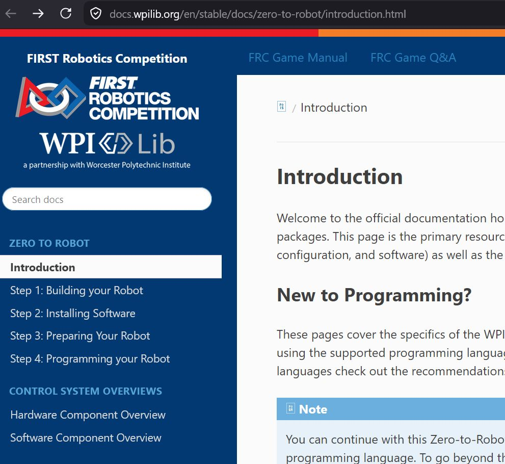
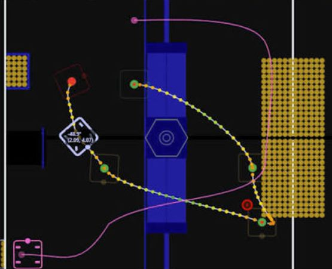
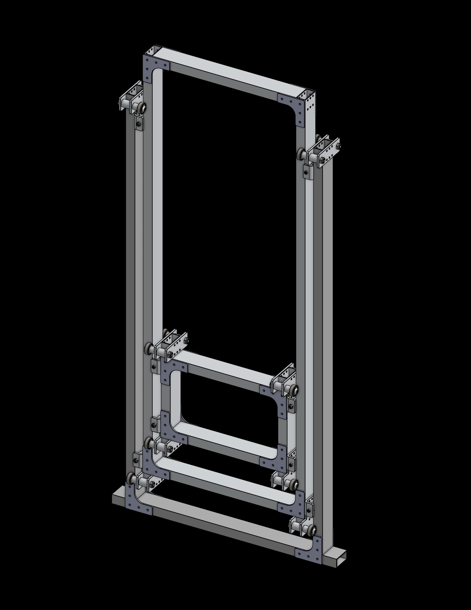

# Intro to Robot Programming

## Intro to Robot Programming

MEZ Teacher/Coach Workshop

## WPILib

- The software library used to program FRC robots
- Created at Worcester Polytechnic Institute
- You’ll need to download it each year, which we’ll do now

## WPILib Docs

- Search for “frc zero to robot”
- Find the FIRST Robotics Competition Documentation
- Click “Step 2: Installing Software”
- Click “WPILib Installation Guide” and follow the directions for the WPILib Installer

## Rev Hardware Client

- Used for configuring Rev hardware, specifically SparkMaxes
- They need CAN IDs, but you can also change other settings and even drive them
- Search for “Rev Hardware Client”
- Click the installation link and install the software

## Why does it matter?

- Software wins matches
- In 2024:
- 528 teams built a kitbot
- 25% of points were scored in auto
- Software, along with driving, is what differentiates teams
- Competitive teams automate tasks in teleop as well, such as aiming

## Examples

- Moving an elevator to an exact position
- Setting a flywheel to an exact speed
- Auto aiming at a goal
- Rumbling the controller when the robot successfully picks up a game piece

## Work Time

- Work on wiring up a complete electrical board
- Use the Rev Hardware Client to ID your motors
- Also use the hardware client to get a motor to spin
- Head to the programming station as a team to make and deploy code changes
