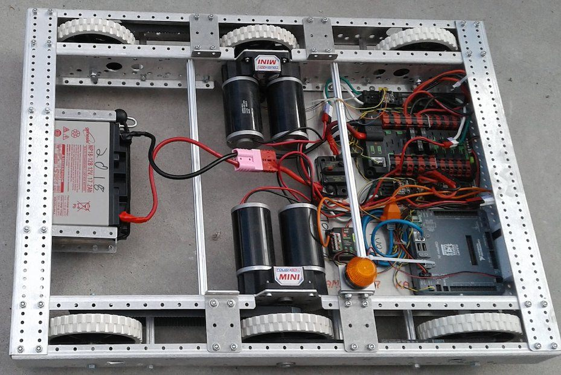
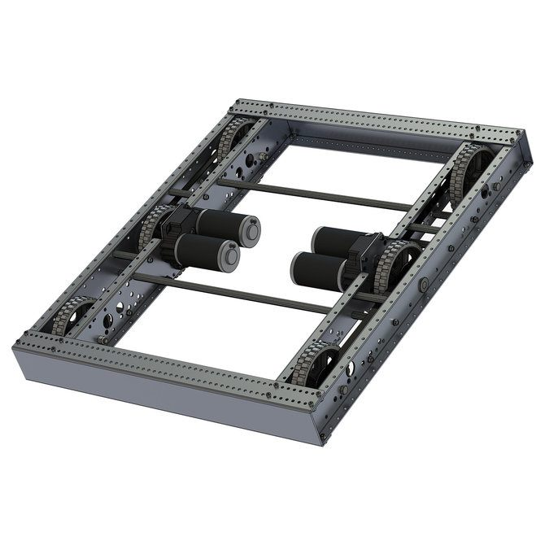
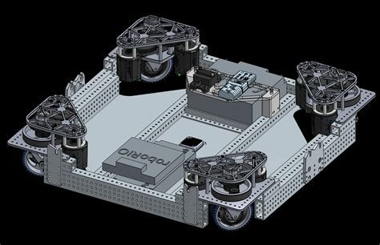
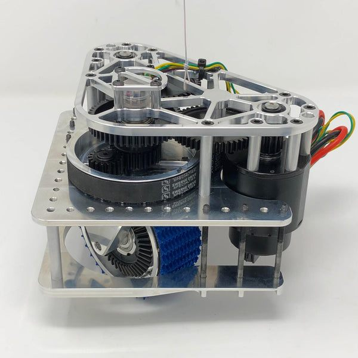
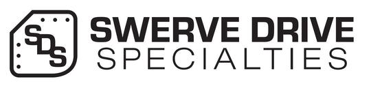
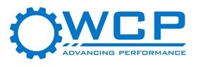
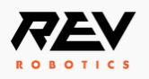
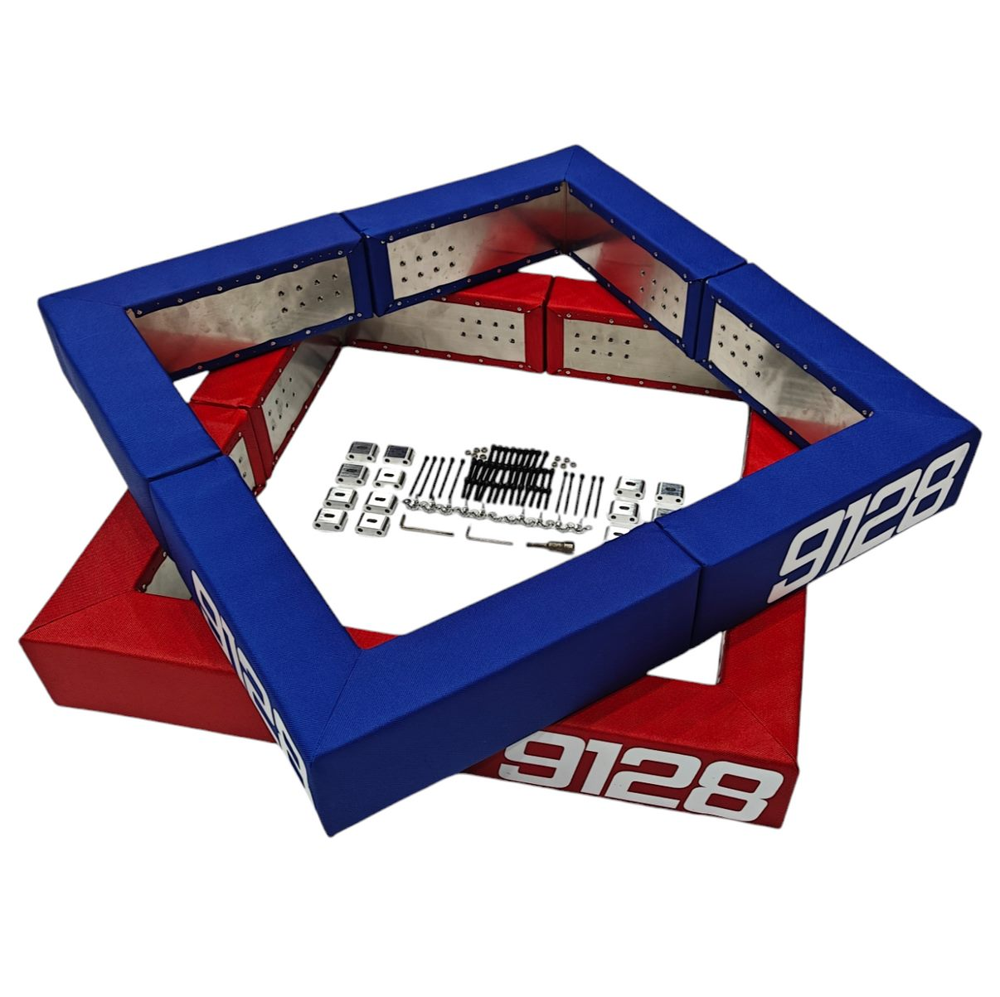
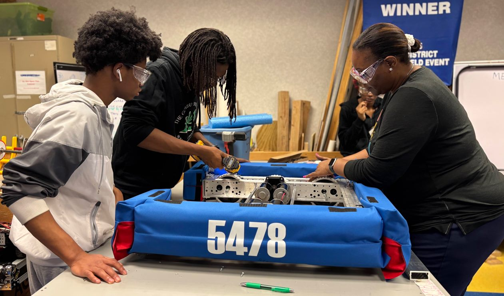

# Overview of Drivetrains & Bumpers

## Overview of Drivetrains and Bumpers

MEZ Teacher/Coach Workshop

## What is a Drivetrain?

- Your drivetrain is, by far, the most important part of your robot.
- Many years, simply having a strong, well-driven drivetrain is enough to make you a highly competitive team.
- There are two main drivetrain options: tank and swerve.
- The best choice varies by team and depends on your resources.

## Tank Drive

- The starter drivetrain
- Three wheels on each side; turns by driving each side at a different speed
- Powered by two motors for each side
- Simple to build and extremely reliable
- Comes free with your season registration unless you opt out
- Lets you focus on scoring mechanisms

## Swerve Drive

- A more advanced option, and more competitive
- Four “modules”, each with one wheel, one in each corner
- Powered by four drive motors and four steer motors (eight total)
- A lot easier than it used to be, but far from trivial
- Expensive - assume $1200+ for modules, plus eight motors and controllers
- If you want swerve, get it working in the fall. It is not recommended to switch to swerve during a build season.

## Which should I pick?

### Tank - choose if:

- This is your first year
- You did not have a week or more of drive practice last season
- Your mechanisms weren’t fully tuned
- You don’t plan on having team meetings before January
- You don’t have $2000+ to spare
- You’re just not sure if you want to commit

### Swerve - choose if:

- You finished early last year and got drive practice time in
- Your mechanisms worked and scored successfully
- The biggest thing holding you back from scoring more was not being able to move sideways
- You have time to build and test it in the fall
- You have at least $2000 allocated for it

There is nothing wrong with choosing tank.

You will never regret a season because your robot didn’t have swerve.

## How do I get it?

### Tank

- The AndyMark kit chassis comes in the kit of parts each year
- The cost is included in your registration fee so you won’t have to pay anything

### Swerve

- You will have to pick a vendor and purchase modules.
- Historically, MEZ teams have used Rev, but we do not recommend this going forward.
- For 26-27, the MEZ will recommend West Coast Products Swerve X2 variants, but other vendors such as Swerve Drive Specialties are reasonable.
- Make sure whatever you pick is compatible with the motors you have.
- If you go swerve, remember to opt out of the kit chassis.

## Bumpers

- Bumpers seem like an afterthought but they are a critical robot component
- If your bumpers are out of spec, you will not be able to play matches
- The rules change a little bit year to year and the specifics matter a lot
- Even so, the gist is you need foam protecting most or all of your robot frame

## Bumper Day

- The MEZ will do Bumper Day again in 2027
- Friends come in and help mass-produce bumper components for every team
- This includes fabric, foam, wood backing, and numbers
- Try to attend, but either way, take bumpers seriously and allocate time in advance towards building them!

