# Wiring Basics

## Wiring Basics

MEZ Teacher/Coach Workshop

[tinyurl.com/wiringbasics](https://tinyurl.com/wiringbasics)

## Wiring in FRC

- Mostly a matter of pulling up a diagram and following it
- Care and precision is helpful
- Pay attention to wire gauge
- Pay attention to which color of wire goes where
- Black to black and red to red
- Yellow to yellow and green to green

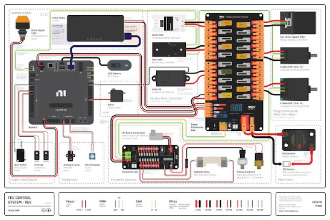

## Wire Gauge

- Gauge or AWG (American Wire Gauge) is the size of wire
- A smaller number means bigger wire
- In FRC, the most common gauges are:
- 6 for battery cable
- 12 for motor wires
- 18-22 for light power and signal wires
- There are always exceptions

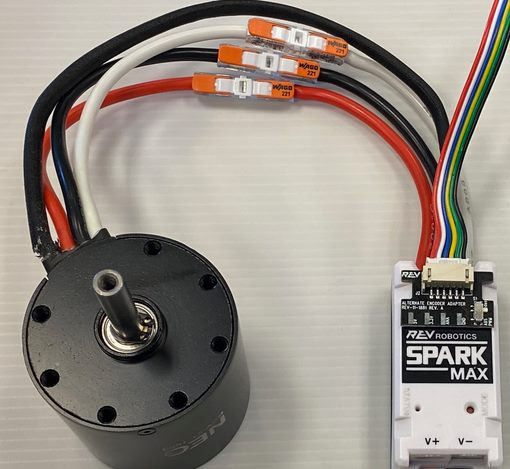
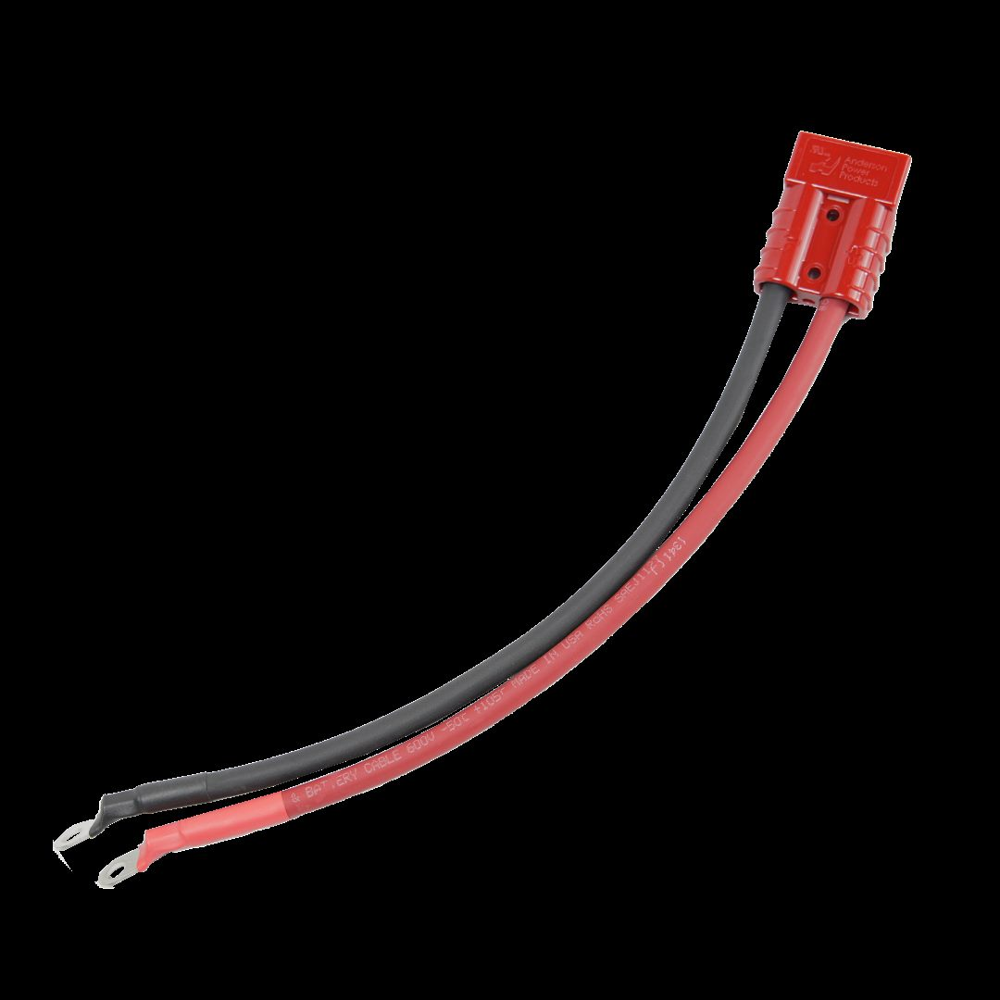

## Connections

- One of the biggest failure points for robots
- Wagos/lever nuts
- Anderson crimps
- Molex crimps
- Soldering
- Care and aggressive testing are more important than which method you use

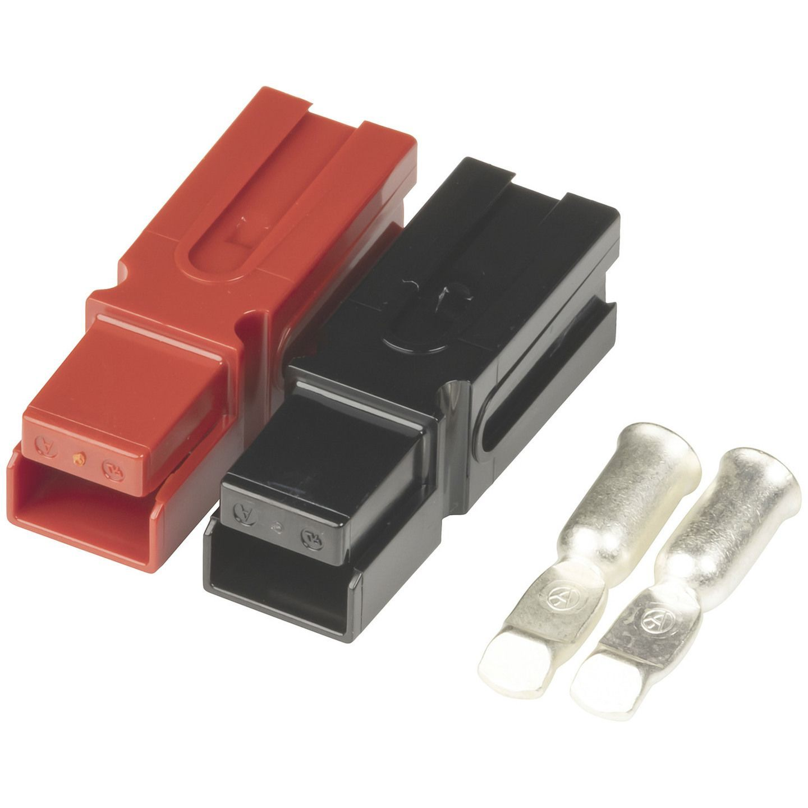
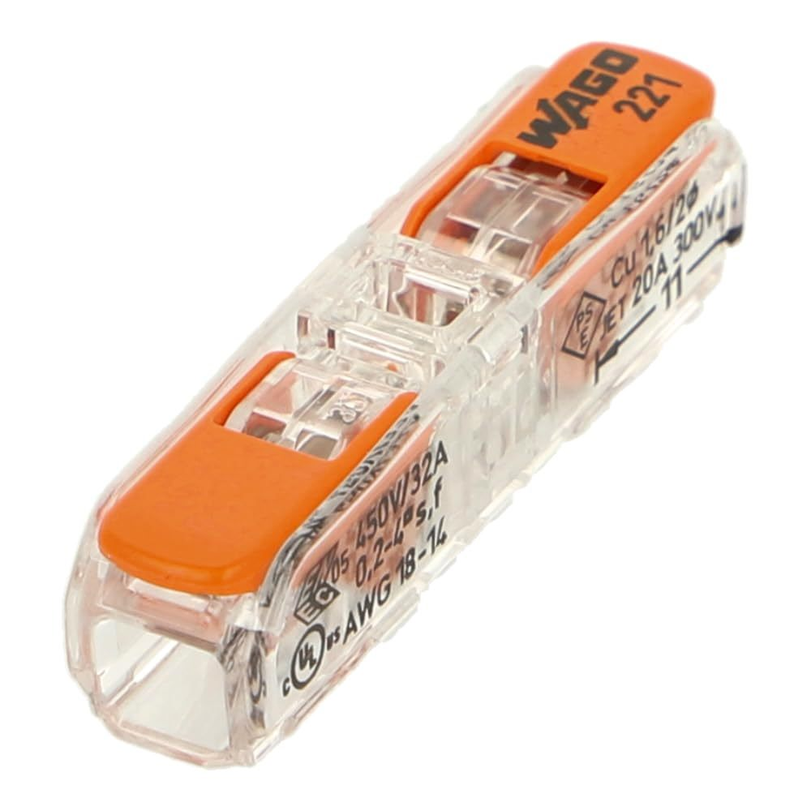

## Wiring Tools

### Wire Cutters

- Designed to cut metallic wire without quickly getting dull.
- Often combined with wire strippers in a single tool.

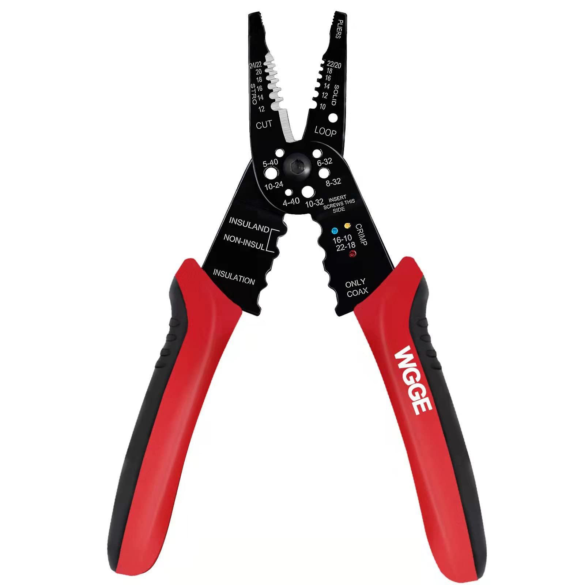

### Wire Strippers

Designed to pull the ends of sheathing off of a run of wire.

### Crimpers

- Crushes some kind of connector onto a wire.
- Can be generic, but also there are many designed for certain kinds of crimps.

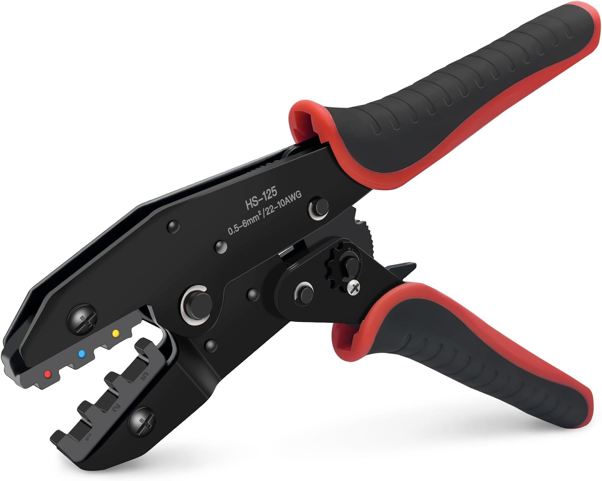

## Flush Cutters

- Flush cutter blades are off-center so that they can cut something flush with another surface
- Non-flush ziptie cuts are surprisingly dangerous
- The MEZ will buy a large stock of these before the season
- Safety glasses are very important - the cut piece will sometimes go flying

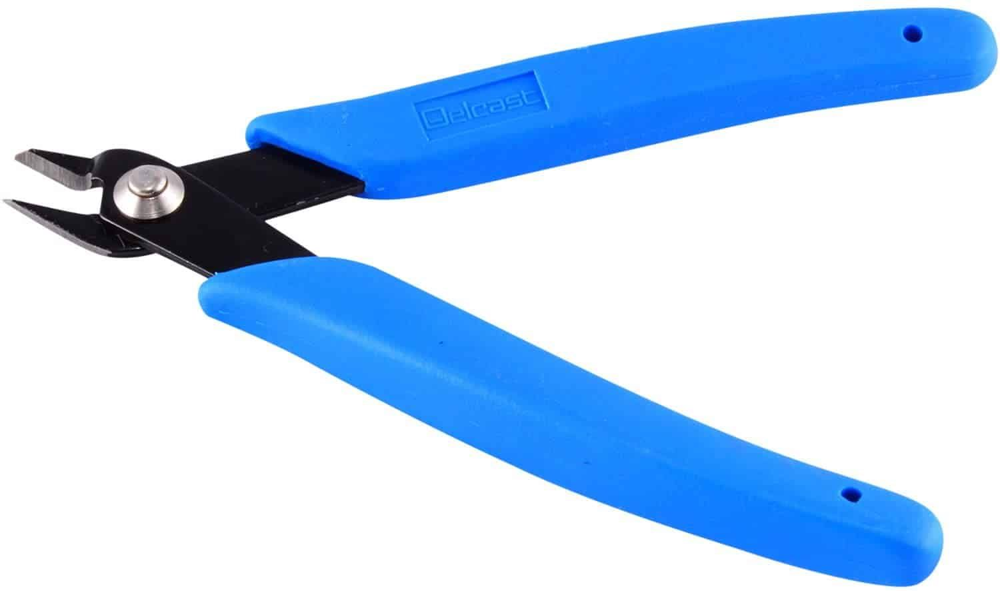

## Shorts

- Short circuits, or shorts, happen when there’s a connection where there shouldn’t be
- Electricity can take a shorter path than intended, which often overloads an item
- Main causes:
- Connecting the wrong things to each other
- A loose strand of wire sticking out of a connector
- Debris on electrical components

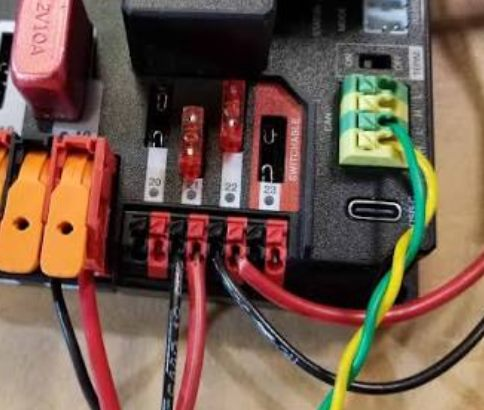

## Fuses

- Single-use circuit breaker
- If there’s too much current, it literally breaks the circuit, in this case by burning
- Unlike snap-action breakers, once a fuse burns, it must be physically replaced
- If you don’t fix the short, the replacement will immediately burn out too

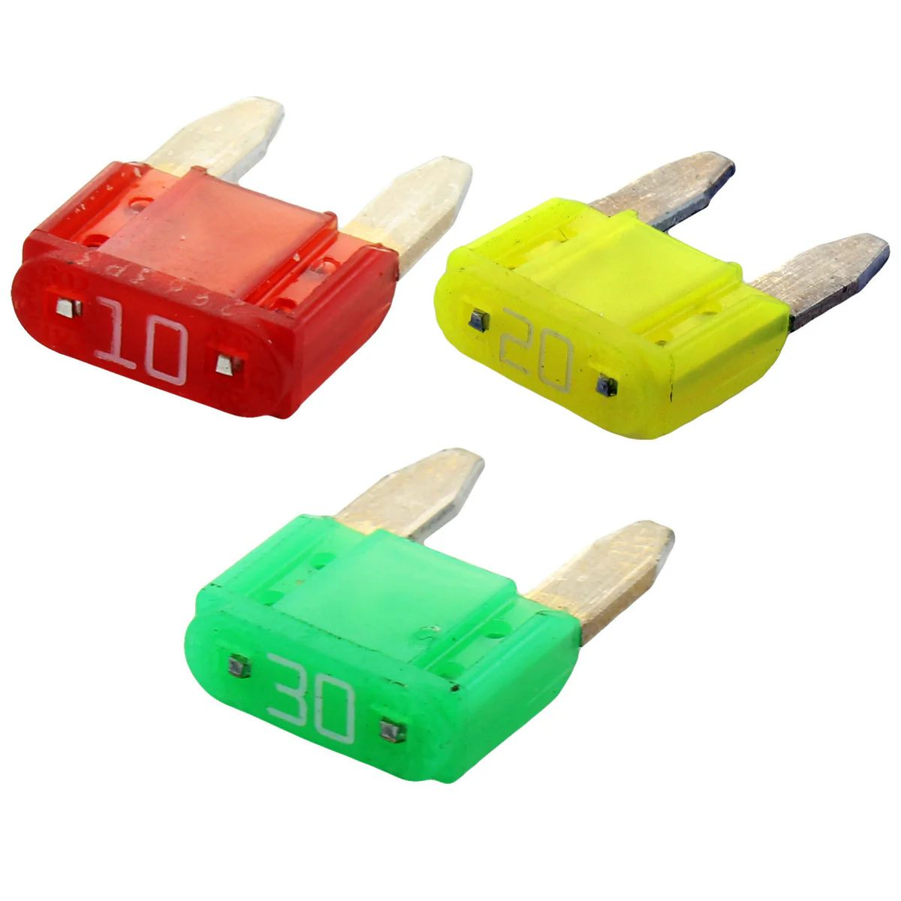
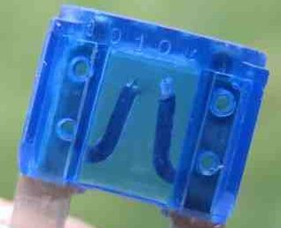

## Technical Practice

- Cut short-but-workable sections of wires of each different gauge
- Strip both ends of each wire
- Connect your wires together with wire nuts - Wagos for big, off-brand for small
- Make sure to tug test your connections
- Disconnect the wires
- Put one end of each wire into your PDP/PDH
- Make sure to tug test your connections
- Disconnect the wires from your PDP/PDH
- Add crimps to your wires
- Make sure to tug test your crimps
- Use a couple zip ties (on anything) and then cut them flush with a flush cutter
